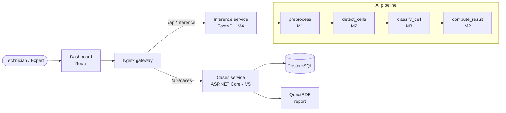

# HackCure: AI-assisted Malassez cell counting

## 1. Overview

HackCure is a **decision-support tool** for counting cells on a Malassez counting chamber. From a microscope
image, it finds the grid, detects every cell, flags cells that look abnormal, applies the counting border rule
and computes the concentration (cells/µL). **An expert reviews, corrects if needed, and validates every result**
before a PDF report can be produced. "Abnormal" labels are **flags for review, not a diagnosis**. HackCure is a
hackathon prototype, not a certified medical device.

## 2. Architecture

- **Dashboard** (React): upload, review, correction, validation, report download.
- **Nginx gateway**: a single entry point that routes to the two services.
- **Inference service** (FastAPI, M4): `POST /images`, `POST /analyze/{image_id}`, `GET /health`. Runs the
  three AI stages in-process: preprocessing (M1), detection and counting (M2), classification (M3).
- **Cases service** (ASP.NET Core + PostgreSQL + QuestPDF, M5): samples, stored results, corrections,
  validations, PDF reports.



Typical flow (PROPOSED): the dashboard creates a sample in the cases service, uploads the image to the
inference service, calls `/analyze`, and posts the result to `POST /samples/{id}/result`. The expert then
corrects or validates the sample and downloads the report.

## 3. Repo structure and ownership

| Path | Owner | Contents |
|---|---|---|
| `contracts/` | whole team (changes by PR only) | JSON schemas, examples, `interfaces.py`, `db_schema.sql`: **source of truth** |
| `fakes/` | setup | fake images and JSON, `stubs.py`, mock inference server, generator, validator |
| `ai/preprocessing/` | M1 Isra | `preprocess()`: clean image + rectangle coordinates |
| `ai/detection/` | M2 Imene | YOLOv8 `detect_cells()`, border rule + concentration `compute_result()`, counting error |
| `ai/classification/` | M3 Sarah | ResNet18 / EfficientNet-B0 `classify_cell()`, accuracy and F1 |
| `services/inference/` | M4 Yasmine | FastAPI `/images`, `/analyze`, `/health` chaining M1 → M2 → M3 |
| `services/cases/` | M5 Eya | ASP.NET Core sample, result, correction, validation, PDF endpoints + PostgreSQL |
| `golden_set/` | whole team | 3–4 real images + manual counts, to fill in |
| `docs/` | whole team | notes, demo script, dataset records |
| `docker-compose.yml` | each owner fills their block | skeleton only |

## 4. How we work in parallel

- **Branches:** each member works on a branch named after their folder (`ai/preprocessing`, `ai/detection`,
  `ai/classification`, `services/inference`, `services/cases`) and merges to `main` by PR.
- **Work against `/fakes` until H7.** Nobody waits for anybody: every input you need exists as a fake file,
  a stub function or the mock server.
- **Never change a contract without a PR to `/contracts` and an announcement to the whole team.** Run
  `python fakes/validate_fakes.py` in that PR. If you change a schema, update the examples and fakes in the same PR.
- Keep the exact signatures in `contracts/interfaces.py`. Integration is then an import swap, not a rewrite.

## 5. Per-member quick start

```bash
pip install -r fakes/requirements.txt                         # numpy, pillow, jsonschema
pip install -r fakes/mock_inference/requirements.txt          # only if you run the mock server
```

| Member | Develop against | Check your output against | Replaces at integration |
|---|---|---|---|
| **M1 Isra** | `fakes/images/malassez_0{1,2,3}.png`; `malassez_blurry.png` / `malassez_dark.png` for quality rejection | `fakes/json/<name>.preprocess.json` (rectangles), `preprocess_output.schema.json` | `fakes.stubs.fake_preprocess` |
| **M2 Imene** | images + `fakes/json/<name>.preprocess.json` as hand-written rectangles; `<name>.detections.json` + `.classifications.json` as `compute_result` input | `<name>.detections.json`, `<name>.result.json` (border rule, formula) | `fake_detect_cells`, `fake_compute_result` |
| **M3 Sarah** | crops `image[y:y+h, x:x+w]` from `<name>.detections.json` | `<name>.classifications.json` (same order as detections) | `fake_classify_cell` |
| **M4 Yasmine** | `fakes.stubs.fake_analyze(image, dilution_factor)` behind your endpoints; `fakes/mock_inference/app.py` as the HTTP reference | `result.schema.json`, `post_images_response.schema.json`, `error.schema.json` | `fake_analyze` → real pipeline |
| **M5 Eya** | `fakes/json/samples.json` (all statuses) as seed data; mock server at `http://127.0.0.1:8001` | cases schemas in `contracts/`, `db_schema.sql` | mock URL → real inference URL |

Load an image the way every stage expects (RGB uint8, H×W×3): `fakes.stubs.load_image(path)`.

Run the mock inference server (from the repo root):

```bash
python -m uvicorn --app-dir fakes/mock_inference app:app --port 8001
```

The mock knows `img_malassez_01`, `img_malassez_02` and `img_malassez_03` without an upload. Uploading a file whose
name contains `blurry`, `dark` or `overexposed` returns a quality rejection. A name containing `fail` gives an
image whose `/analyze` returns 500 `analysis_failed`. Use 127.0.0.1 rather than `localhost`, or change `--port`,
if another program already uses port 8001.

### Fake data for M3 (classification)

Ready-made labelled crops, so M3 can write and test data loading, training and evaluation code before the real
detector exists. Nothing needs to run first:

```python
from torchvision.datasets import ImageFolder
ds = ImageFolder("fakes/crops")      # 120 RGB crops 224×224; classes {'abnormal': 0, 'normal': 1}
```

| File | What |
|---|---|
| `fakes/images/fake_cells.png` | 1024×1024 RGB image, as if it came out of `preprocess()`: light background, grid, 120 non-overlapping cells. 96 are "normal" (small, round, dark) and 24 "abnormal" (bigger rotated ellipse with a bump, orange). 6 cells hug the image border, to exercise the crop padding |
| `fakes/json/fake_cells.detections.json` | Exactly the `detect_cells()` contract (`detections.schema.json`): `[{"x", "y", "w", "h", "score"}]`, no labels and no id. A cell's id is its index in this list |
| `fakes/json/fake_cells.labels.json` | True label per detection, **same order** as the detections: `[{"label": "normal" \| "abnormal"}]` |
| `fakes/crops/normal/`, `fakes/crops/abnormal/` | `crop_cell()` output for every cell, as `cell_<id:04d>.png` |
| `fakes/crops/labels.csv` | `crop_path` (relative to `fakes/crops/`), `cell_id`, `label`, `x`, `y`, `w`, `h` |
| `fakes/images/fake_cells_overlay.png` | Every box drawn: green = normal, red = abnormal |
| `ai/common/crop.py` | Shared helpers `crop_cell`, `export_crops`, `draw_labeled_overlay` (signatures also in `contracts/interfaces.py`) |

> ⚠️ **The drawn cells are for testing code only.** Never train a model you will use on them, and never report
> accuracy or F1 measured on them. Real metrics come from the real dataset's held-out split.

Regenerate (deterministic, overwrites only the files above): `python fakes/generate_fake_cells.py`. Then run
`python fakes/validate_fakes.py`, which checks one label per detection, that every crop in `labels.csv` exists
and is 224×224 RGB, and that the counts per class match `fake_cells.labels.json`.

Open questions for this data:
- **Box format:** `x, y` = top-left corner, plus `w, h`. This is already fixed by `contracts/detection.schema.json`, so it is not an open question.
- **PROPOSED — M3 confirms:** crop size 224 and margin 0.25. The side of the square crop is `max(w, h) × 1.5`, with replicate padding at image edges.
- **PROPOSED — needs a contract PR:** who does the cropping in the real pipeline. The proposal is M3's stage, via
  `ai/common/crop.py`. The current contract (`interfaces.py`) still says `classify_cell` receives the exact box
  `image[y:y+h, x:x+w]`, and `fakes/stubs.py` relies on that. A classifier trained on `crop_cell` crops (with
  margin, 224×224) would see differently framed inputs at inference until this is settled. Options: change the contract
  so M4 passes `crop_cell(image, det)`, or train on exact-box crops.

## 6. Integration plan (H7)

Swap one stage at a time, in this order. After each swap, run the checklist before moving on. If a step fails,
revert just that import and keep going with the fake.

| # | Swap | Who | Checklist |
|---|---|---|---|
| 0 | Before H7: all branches merged to `main`, `python fakes/validate_fakes.py` shows 0 failed | all | ☐ CI or local run green ☐ every member's code imports from `main` |
| 1 | `fake_preprocess` → real `preprocess` | M1 + M4 | ☐ on fake images, rectangles within a few px of `<name>.preprocess.json` ☐ on each golden image, the overlay of the rectangles is visually right and the rectangle count matches `rectangles_counted` ☐ `malassez_blurry.png` and `malassez_dark.png` are rejected |
| 2 | `fake_detect_cells` + `fake_compute_result` → real | M2 + M4 | ☐ on fake images, `total_count` equals `<name>.result.json` (the border rule cases are built in) ☐ on the golden set, counting error \|AI − manual\| / manual is recorded per image ☐ concentration matches the formula by hand for one image |
| 3 | `fake_classify_cell` → real `classify_cell` | M3 + M4 | ☐ output matches `classification.schema.json` ☐ `abnormal_count` on the golden set compared with `manual_abnormal` ☐ accuracy/F1 from the held-out set written in `docs/` |
| 4 | `fake_analyze` → real pipeline inside `/analyze` | M4 | ☐ `/health` shows `models_loaded: true` ☐ every golden image through HTTP returns a body valid against `result.schema.json` ☐ a bad image returns `error.schema.json`, never a partial result ☐ time per image noted |
| 5 | Cases service: mock URL → real inference URL | M5 | ☐ end to end: create sample → upload → analyze → post result → correct → validate → download PDF ☐ report refused (409) before validation ☐ no patient identifier anywhere in the DB or PDF |

## 7. Timeline

| Hours | What |
|---|---|
| H0–H1 | Agree on contracts (this PR); everyone runs the fakes |
| H1–H7 | Parallel work against fakes. Model training starts at H2 (M2, M3) |
| H4 | Check-in: each member demos against fakes; contract issues raised now, not at H7 |
| H7 | Integration, following the swap order in §6 |
| H9 | Code freeze: bug fixes only |
| H10–H12 | Demo prep: golden-set numbers, slides, demo script, rehearsal |

## 8. Regenerating and validating the fakes

```bash
python fakes/generate_fakes.py     # deterministic: same seed, same files
python fakes/validate_fakes.py     # schemas + formula + cross-file consistency (+ mock server, if FastAPI is installed)
```

The validator checks every contract example and every fake against its schema, then checks the arithmetic:
`total_count == len(cells)`, `abnormal_count` equals the abnormal labels, and
`concentration_per_uL == total_count / rectangles_counted × 100 × dilution_factor`. It also checks that each
result's cells are detection centres, that the stubs reproduce every result, that `samples.json` covers every
status consistently, and that the mock server returns contract-shaped bodies. Exit code 0 means everything passes.

## 9. Data and ethics

- **Only public, anonymized datasets** for training and testing. Record each one below before using it.
- **No patient identifiers anywhere**: not in file names, image metadata (strip EXIF), the database, logs or
  reports. Samples are identified by generated codes (`S-YYYYMMDD-NNN`). `technician` and `validator` hold staff
  pseudonyms.
- **Tunisian law:** personal data, including health data, are protected by Organic Law No. 2004-63 of
  27 July 2004 and supervised by the INPDP (Instance Nationale de Protection des Données Personnelles). Any use of
  real lab images beyond public anonymized datasets must be cleared with the lab and checked against INPDP
  requirements first.
- **Not a certified medical device.** HackCure is a hackathon prototype for decision support. Every count is
  validated by a qualified expert, and "abnormal" is a flag for review, not a diagnosis.

| Dataset | Used by | Licence | Link | Anonymized? | Notes |
|---|---|---|---|---|---|
| TODO | M2 detection | TODO | TODO | TODO | |
| TODO | M3 classification | TODO | TODO | TODO | |
| TODO | golden set | TODO | TODO | TODO | |

## 10. Open questions

Every item below is a choice made to fill a gap in the original spec. **PROPOSED — confirm with team.**

**Counting**
1. **Border rule: count cells touching the top and left lines, exclude cells touching the bottom and right lines.
   To confirm with the lab protocol.** Proposed precise form: a cell is counted in a rectangle if its box overlaps
   the rectangle and does not touch or cross the rectangle's bottom or right line. This counts each cell at most once.
   Under this rule, a cell on the grid's top-right or bottom-left outer corner is excluded. The fakes avoid corners.
2. `preprocess()` returns only the rectangles to count, and `rectangles_counted = len(rectangles)`. Which
   rectangles of the chamber to count (all 100, or a subset) depends on the lab protocol, and M1 applies it.
3. `result.cells` holds only the counted cells, so `total_count == len(cells)`. The spec example (1 cell, total 412) was abbreviated.
4. `concentration_per_uL` is rounded to 2 decimals. The validator's tolerance is 0.01.
5. `confidence` = mean of the counted cells' classification scores, rounded to 2 decimals, or 0 if there are no cells.

**AI interfaces**

6. Images are RGB `uint8` arrays (H×W×3). All coordinates are int pixels in the frame of the image returned by `preprocess()`.
7. A result cell's `x`, `y` is the centre of its detection box (`x + w // 2`, `y + h // 2`), and its `score` is the classifier score.
8. The `classify_cell` score is the probability of the returned label.
9. Per image, `classifications` are aligned with `detections` by order, with no id field.
10. The `cells` argument of `compute_result` is `[{"detection": {...}, "classification": {...}}]` (`classified_cells.schema.json`).
11. In JSON (`<name>.preprocess.json`), the ndarray `image` is serialized as a relative file path.

**Inference service**

12. `POST /images` takes multipart/form-data with field `file`. Accepted and rejected images both return HTTP 200. The accepted body is exactly `{"image_id"}`.
13. Rejection shape `{"accepted": false, "reason": "blurry" | "too_dark" | "overexposed", "detail": "..."}`.
14. `POST /analyze/{image_id}` takes the dilution in a JSON body, `{"dilution_factor": number}`, because the spec does not say where it comes from.
15. `GET /health` returns `{"status": "ok", "models_loaded": bool}`.
16. Both services use one error shape for every 4xx/5xx, `{"error": {"code", "message"}}`, with the codes and HTTP statuses listed in `contracts/README.md`.
17. Gateway routes `/api/inference/*` and `/api/cases/*`. Suggested ports are in `docker-compose.yml`.

**Cases service**

18. Added `GET /samples/{id}` (not in the spec) returning `sample_detail` (sample + images + latest result + validation). The mutations return the same shape.
19. The dashboard (not the cases service) calls inference and then `POST /samples/{id}/result` with `{"image_id", "model_version", "result"}`. `model_version` is in this body because the result JSON has none.
20. `images.id` = the inference `image_id`. `file_path` is nullable because the inference service stores the file. No endpoint records rejected images yet, so `quality_ok` / `rejection_reason` are unused until one is added.
21. Corrections live in the `validations` row (one per sample, `validated_at` null until validated). Validating directly from `pending` leaves `corrected_*` null, which means the AI result was accepted unchanged. `corrected → corrected` is allowed, and `validated` is final.
22. The cases API uses the DB column names `concentration` and `cells` (for `cells_json`).
23. IDs are UUIDs (except `images.id`). Sample code format is `S-YYYYMMDD-NNN`. `technician` and `validator` are free-text staff pseudonyms.
24. PDF report contents, and whether it shows a corrected concentration recomputed from `corrected_count`, are for M5 to propose.

**Fakes and setup**

25. The spec says "3 images, including one blurry and one dark", which would leave one usable image. The fakes have 3 good images plus 2 quality-test images (blurry and dark copies of `malassez_01`).
26. `golden_set/manual_counts.csv` format (see `golden_set/README.md`).
27. The repo was empty, so `main` got one empty "Initial commit" as the PR base.
28. M3 fake data: crop size 224 and margin 0.25, and who does the cropping in the real pipeline (exact-box crop in the contract vs `crop_cell`). See "Fake data for M3" in §5.
