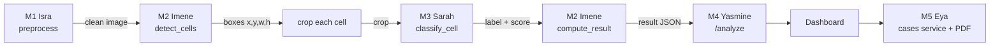

# M3 Classification: what was built and how it connects

**Owner:** M3 Sarah · **Code:** [`ai/classification/`](../ai/classification/) · **Branch:** `classification`

Usage details (commands, environment variables) are in [`ai/classification/README.md`](../ai/classification/README.md).
This page explains what the stage does, the results, and what each other member needs to know.

## 1. What this stage does

For every cell the detector finds, M3 answers one question: **does this cell look normal or abnormal?**

```python
classify_cell(crop) -> {"label": "normal" | "abnormal", "score": float}
```

- `crop`: one cell's image, RGB `uint8`, shape (H, W, 3). Any size; the classifier resizes it.
- `score`: the probability of the returned label, in [0, 1].
- "abnormal" is a **flag for expert review, not a diagnosis**.

The signature is the one fixed in [`contracts/interfaces.py`](../contracts/interfaces.py), and the output matches
[`contracts/classification.schema.json`](../contracts/classification.schema.json). At integration it replaces
`fakes.stubs.fake_classify_cell` with no other code change.

## 2. What was done

| Step | What |
|---|---|
| Model | ResNet18 pretrained on ImageNet, with a new 2-class head (EfficientNet-B0 also supported via `--arch`) |
| Data | Roboflow **Leukemia-Cells v1**, classification export, split into `train` / `valid` / `test`. `effected-cells` → abnormal, `normal-cells` → normal |
| Training | On Colab GPU, in two phases: head only (2 epochs, lr 1e-3), then the whole network (8 epochs, lr 1e-4). Seed 0 |
| Checkpoint choice | After each epoch, the model with the best **F1 on the abnormal class** on `valid` is saved as `best.pt` |
| Threshold | A cell is flagged abnormal when p(abnormal) ≥ **0.25** (not 0.5). Chosen on `valid` to favour recall: missing an abnormal cell is worse than asking the expert to check a normal one |
| Evaluation | Run **once** on the held-out `test` split, never used for any choice |
| Inference | `classify_cell` for one crop, and `classify_cells` for a batch (much faster on CPU for hundreds of cells). Weights load once, on the first call |
| Tests | Contract tests with an untrained model, so they run without real weights: `python -m pytest ai/classification/tests` |

### Handling the domain gap

The training images are **stained** blood smears; Malassez chamber images are **unstained**. So the training
augmentations randomize or remove colour, and use flips, rotations and a varied crop framing. Expect the real
accuracy on Malassez images to be **lower** than the numbers below until it is checked on the golden set.

## 3. Results (held-out test split)

353 test images (244 abnormal, 109 normal), threshold 0.25:

| Metric | Value |
|---|---|
| Accuracy | 0.847 |
| F1 (abnormal) | **0.893** |
| Precision (abnormal) | 0.863 |
| Recall (abnormal) | **0.926** |
| Macro F1 | 0.812 |

| | predicted normal | predicted abnormal |
|---|---|---|
| **true normal** (109) | 73 | 36 |
| **true abnormal** (244) | 18 | 226 |

How to read this:
- 93% of abnormal cells are flagged, which is the goal of a review tool.
- About one normal cell in three (36/109) is also flagged. That is the cost of the low threshold; the expert clears these.
- The test set is 69% abnormal, so accuracy alone overstates quality. F1 and recall are the numbers to quote.

On the validation split, the same threshold gave F1(abnormal) 0.892 and recall 0.935.

## 4. How M3 connects to the other members



| Member | Relation to M3 | What they need from me / I need from them |
|---|---|---|
| **M1 Isra** (preprocessing) | Indirect, upstream | M1's output image is the frame all boxes refer to. If M1 changes colour or contrast, the crops M3 sees change too |
| **M2 Imene** (detection) | **Direct, upstream and downstream** | Upstream: M3 classifies one crop per box from `detect_cells()`. Downstream: `compute_result()` takes each detection paired with its classification (same order, no id) and counts `abnormal_count` |
| **M4 Yasmine** (inference service) | **Direct: calls my code** | M4 imports `from ai.classification import classify_cell` (or `classify_cells`), cuts the crops, and must ship `weights/best.pt` with the service. `/health`'s `models_loaded` should include the classifier |
| **M5 Eya** (cases service) | Indirect, downstream | Stores the result (`abnormal_count`, per-cell labels and scores) and shows it in the PDF. The expert's corrections on flagged cells happen there |
| **Whole team** (contracts, golden set) | Shared | Contract changes go through a PR to `contracts/`. On the golden set, compare `abnormal_count` with `manual_abnormal` |

The per-cell `score` also feeds the result's `confidence` (mean of the counted cells' scores), computed by M2.

## 5. What M4 needs to deploy it

1. Get `best.pt` (shared separately: `*.pt` files are gitignored and never committed) and put it at
   `ai/classification/weights/best.pt`, or set `HACKCURE_CLASSIFIER_WEIGHTS` to its path.
2. Install `ai/classification/requirements.txt` (PyTorch, torchvision, Pillow, numpy).
3. Optional settings: `HACKCURE_ABNORMAL_THRESHOLD` (default 0.25) and `HACKCURE_DEVICE` (default `cpu`).
4. If the weights file is missing, the first call raises `FileNotFoundError`. The service should return
   an `error.schema.json` body, never a partial result.

## 6. Open points to settle with the team

- **Who crops, and how (needs a contract PR).** The contract says `classify_cell` receives the exact box
  `image[y:y+h, x:x+w]`. The model was trained with framing variations so it tolerates both, but the cleanest
  choice is for M4 to pass `crop_cell(image, det)` from [`ai/common/crop.py`](../ai/common/crop.py)
  (square, 25% margin, 224×224). To agree with M2 and M4.
- **Threshold on real images.** 0.25 was tuned on stained smears. Re-check it on the golden set; if the expert
  is flooded with false flags, raise it.
- **Dataset record.** Link, licence and image counts for Leukemia-Cells v1 still need to go in the dataset table
  of the root README (§9).
- **Integration step 3** (root README §6): output valid against the schema, `abnormal_count` compared with
  `manual_abnormal` on the golden set, and these metrics recorded here.
